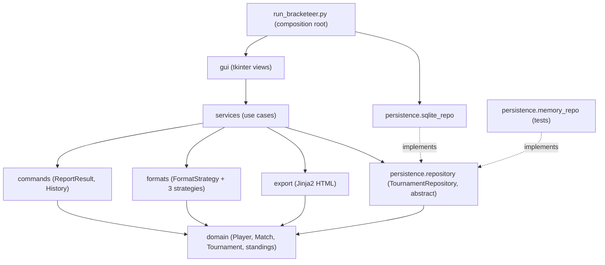

# ADR-0003: Layered architecture with a services layer

## Context and Problem Statement

Bracketeer has a tkinter GUI, tournament rules (three formats and their tiebreakers), undoable commands, SQLite storage and an HTML exporter. The rules must be testable by thousands of Hypothesis examples without a window or a database. The storage must be swappable for an in-memory fake. The GUI is built after the logic, in Phase 5.

Use cases such as "report a result" need a home that both the GUI and the tests can call.

How should the code be divided, and which parts may import which?

## Decision Drivers

* Domain rules testable in isolation, fast, without the GUI or SQLite
* Storage replaceable by a fake (Repository pattern, ADR-0005)
* The GUI must never contain SQL or rules, so it can be built late and stay thin
* One place where a use case lives, such as "report a result", so the GUI and the tests call the same code
* Simple enough for one developer in a few weeks

## Considered Options

* GUI calls the repository and the domain directly (two layers)
* **Layered architecture with a services (application) layer**
* Hexagonal architecture (ports and adapters)

## Decision Outcome

Chosen option: **layered, with a services layer**, because it meets every driver above with the least ceremony.

### The dependency rule

Arrows mean *may import*. Nothing may import in the opposite direction.

| Package | May import from `bracketeer` | Must not import |
|---|---|---|
| `domain` | nothing (standard library only) | everything else |
| `formats` | `domain` | `services`, `persistence`, `gui`, `export`, `commands` |
| `commands` | `domain` | `services`, `persistence`, `gui`, `export` |
| `export` | `domain` | `services`, `persistence`, `gui` |
| `persistence` | `domain` | `services`, `gui`, `formats`, `commands`, `export` |
| `services` | `domain`, `formats`, `commands`, `export`, `persistence.repository` (the abstract class only) | `gui`, `persistence.sqlite_repo`, `sqlite3` |
| `gui` | `services` | `persistence`, `sqlite3`, `formats`, `commands` |
| composition root | anything | n/a |

Only the composition root (`run_bracketeer.py`, or `main()` in `gui/app.py`) creates the `SqliteTournamentRepository` and passes it to the services. That is dependency injection. It's why tests can pass an `InMemoryTournamentRepository` instead.

### Calls versus imports

The chain *GUI → services → domain → persistence* describes the direction of **calls at runtime**. At the level of **imports**, `persistence` depends on `domain`, not the other way round: the repository turns rows into domain objects, and the domain never knows a database exists. Inverting that compile-time dependency, so it points against the call, is the Dependency Inversion Principle. It's the reason the in-memory fake works.

### Consequences

* Good, because the domain and formats can be property-tested thousands of times per second, with no I/O.
* Good, because swapping SQLite for the in-memory fake is a one-line change in the composition root.
* Good, because the GUI built in Phase 4 only translates clicks into service calls, which keeps it small and keeps most GUI logic out of untested code.
* Good, because the services layer is where the Command pattern's History lives, so undo works the same from the GUI and from tests.
* Bad, because simple actions pass through an extra layer, which is some boilerplate.
* Bad, because the rule only holds if it's checked. Python won't stop a bad import on its own.

### Confirmation

* `tests/unit/test_architecture.py` (Phase 2) parses every module under `src/bracketeer` with `ast` and fails if an import breaks the table above. It uses only the standard library, so it adds no dependency.
* The test runs in CI on every PR, so a layer violation can't be merged.

## Pros and Cons of the Options

### GUI calls the repository and the domain directly
* Good, because it's the fewest files, and quick for a prototype.
* Bad, because use-case logic ends up in button handlers, where it's hard to test and gets duplicated.
* Bad, because the GUI would depend on the storage, which breaks the in-memory fake.

### Layered with a services layer
* Good, because it's simple, well known and testable.
* Bad, because it adds a pass-through layer, and the dependency rule must be checked by a test.

### Hexagonal (ports and adapters)
* Good, because the domain core is cleanly isolated, and every external thing (GUI, storage, export) is an adapter behind a port.
* Bad, because it needs more interfaces and more ceremony than one developer and a few weeks justify.
* Neutral: the chosen design already does the important part of hexagonal for storage, a port (`TournamentRepository`) with two adapters. It can move further that way if the app grows.

## More Information

* *Architecture Patterns with Python*, chapter 2 (Repository) and chapter 3 (coupling): https://www.cosmicpython.com/
* Related: ADR-0002 (SQLite storage); ADR-0005 (Repository) and ADR-0006 (Command), both Phase 4
