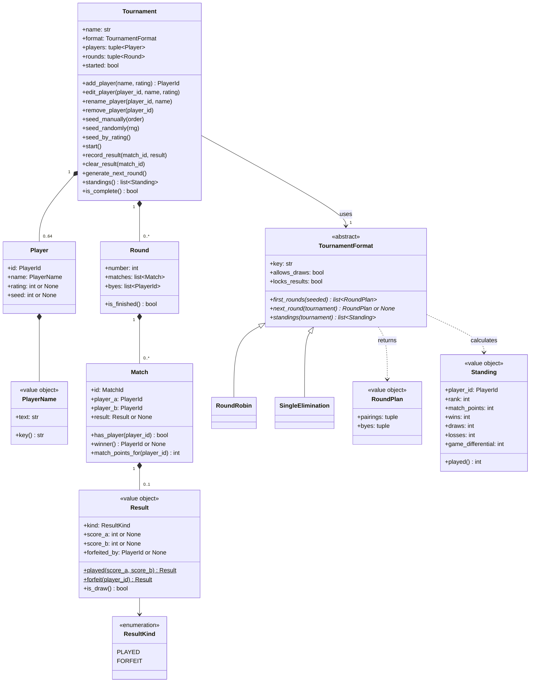

# Design

This document shows how Bracketeer is built to meet its [requirements](requirements/user-stories.md): the layers, the domain classes, the design patterns, and how a tournament is saved. The reasons behind the main choices are in [key-decisions.md](key-decisions.md).

## Layers

Bracketeer is split into layers. Each layer may use the layers below it, never the ones above.


The most important rule is that **the domain layer depends on nothing else**. It does no input or output: no printing or reading what the user types, no files, no network (NFR-MA-1). An automated test reads every module's imports and checks the whole rule: the domain imports only safe standard-library modules, persistence never imports the layers above it, the app layer never imports the interface, and the interface imports only the app layer. This has three benefits:

- The tournament rules can be tested quickly, without running the menus or touching a file.
- The interface or the save format can change without touching the rules. Replacing a planned graphical window with a terminal interface changed only the top layer (see [key-decisions.md](key-decisions.md), decision 2).
- Every rule is enforced in one place, whatever part of the app asks for a change.

Two consequences follow. Randomness is passed into the domain as a `random.Random` object, so a test can fix its seed and get the same result every time. And the domain reports a broken rule by raising a subclass of `DomainError`; the app layer turns it into a plain-language message that the interface shows (NFR-US-2, see [The app layer and the interface](#the-app-layer-and-the-interface)).

## Domain classes

The UML class diagram below shows the domain layer.



In the diagram, a filled diamond is composition (the part belongs to exactly one whole), a hollow triangle is inheritance, and a dashed arrow means one class creates or returns the other. Methods in italics are abstract, and underlined methods belong to the class rather than an instance (`Result.played` and `Result.forfeit` build a new result).

### Entities and value objects

- An **entity** keeps its identity while its data changes. A `Player` is still the same player after a name correction, and a `Match` is still the same match when its result is entered or cleared. Entities compare by identity (`eq=False` on their dataclasses).
- A **value object** is defined only by its values and never changes after it's created (a frozen dataclass). To "change" one, you replace it. `PlayerName`, `Result`, `RoundPlan`, and `Standing` are value objects. Because `PlayerName` checks its own rules when it's created, an invalid name can't exist anywhere in the program.
- **`Tournament` is the aggregate root.** Every change goes through its methods, and outside code refers to players and matches by ID. That way each rule (for example, "names are unique" or "results in a locked round can't change") is checked in exactly one place.
- **Standings and completion are calculated, never stored.** They are worked out from the results each time they're needed, so they can never disagree with the results.

## Design patterns

### Strategy: tournament formats

Each tournament format plans rounds differently, but a tournament treats them all the same way.

| Strategy role     | In Bracketeer                                                                 |
| ----------------- | ----------------------------------------------------------------------------- |
| Strategy          | `TournamentFormat`, an abstract base class                                    |
| Concrete strategy | `RoundRobin`, `SingleElimination`                                             |
| Context           | `Tournament`, which holds a format and calls it without knowing which it is   |
| Client            | The app layer, which picks a format when the organizer creates a tournament   |

A format **answers questions and never changes the tournament**. `first_rounds()` returns `RoundPlan` objects (who plays whom, and who has a bye), and `Tournament` turns each plan into a numbered `Round` with numbered `Match` objects. Match numbers are therefore handed out in one place. `next_round()` plans a round that depends on results: single elimination pairs the winners, and round robin returns `None` because its whole schedule is planned at the start. `standings()` ranks the players: round robin by match points (R-TB-2), single elimination by the round each player was knocked out in (R-TB-4). `Tournament.standings()` simply asks its format, so it contains no checks for which format it has. A format also declares two rules as class attributes: `allows_draws` (R-RS-2) and `locks_results` (R-RS-7).

Adding a format, such as double elimination later, means adding one new class and listing it in the format registry. `Tournament` and the existing formats don't change, which is the open/closed principle: open for extension, closed for modification.

The **format registry** (`formats/registry.py`) lists every format under its `key`. A saved file stores only the key, and `format_for(key)` turns it back into a new format object. An unknown key raises `UnknownFormatError`, so a damaged file produces a message instead of a crash (NFR-RE-2).

`TournamentFormat` is an abstract base class (`abc.ABC`), so a format class that forgets to define a required method fails as soon as it's created, rather than later when the method is called.

### Repository: saving tournaments

`TournamentRepository` (in `persistence/repository.py`) is the only code that reads or writes tournament files. The rest of the app asks it to `save(tournament, path)` or `load(path)` and never deals with JSON directly. This keeps file handling out of the domain, and it means the save format could change (for example, to a database) without touching the rules or the interface.

Turning a `Tournament` into the file's data and back is kept in its own module, `persistence/save_format.py`, so it can be tested without touching any files. When a file can't be saved or opened, the repository raises `SaveFileError` with a plain-language message. `DamagedFileError` (not valid JSON, or not a valid tournament) and `NewerVersionError` are kinds of `SaveFileError`, so the interface catches one exception type for both actions (NFR-US-2).

## Saving a tournament

A tournament is saved as one JSON file with the extension `.bracketeer`, normally in the organizer's `Documents\Bracketeer` folder. Only the facts are stored: the players, their seeds, the rounds, and the results. Standings are recalculated when the file is opened. A shortened example:

```json
{
  "format_version": 1,
  "name": "Friday Smash Night",
  "format": "round_robin",
  "started": true,
  "players": [
    { "id": 1, "name": "Ana", "rating": 1500, "seed": 1 },
    { "id": 2, "name": "Ben", "rating": null, "seed": 2 }
  ],
  "rounds": [
    {
      "number": 1,
      "byes": [],
      "matches": [
        {
          "id": 1,
          "player_a": 1,
          "player_b": 2,
          "result": { "kind": "played", "score_a": 2, "score_b": 1 }
        }
      ]
    }
  ]
}
```

- `format_version` lets a future version recognize older files and refuse newer ones (NFR-RE-3).
- `format` stores the format's key; the format itself holds no data, so the key is enough to recreate it with `format_for` (see the format registry above).
- A match with no result yet has `"result": null`. A forfeit is stored as `{ "kind": "forfeit", "forfeited_by": 2 }`.
- Opening a file treats it as untrusted input. Each value's type is checked first. The tournament is then rebuilt by **replaying** it through `Tournament`'s public methods: add the players, seed them in the saved order, start, and for each round record its results and generate the next round, checking that each rebuilt round matches the saved one. Every domain rule is checked again on the way, so anything invalid, whether the file is damaged or was edited by hand, produces a message instead of a crash (NFR-RE-2, NFR-SE-4, decision 11 in [key-decisions.md](key-decisions.md)).
- Player IDs in the file only connect matches to players. Opening numbers the players 1, 2, 3, ... again, so a gap left by a player removed before the start disappears; everything else, including the standings, is unchanged.
- Saving writes the complete file to a temporary file in the same folder, forces it onto the disk, and then replaces the old file in one step with `os.replace`. A failed save therefore leaves the previous version as it was and no half-written file (NFR-RE-1). Files are always written as UTF-8, whatever the computer's default encoding is, so names such as "Zoë" survive.

## The app layer and the interface

`TournamentSession` (in `app/session.py`) holds the open tournament, the file it was last saved to, the folder where tournaments are kept, and whether it has unsaved changes. The menus read `session.tournament` to show the players, rounds, and standings, but every change goes through a session method, such as `add_player` or `record_score`. Each method that succeeds marks the session as having unsaved changes, so quitting, starting a new tournament, or opening another file asks first (NFR-RE-4, US-10 #2).

When a rule is broken, or a file can't be saved or opened, the session raises `ActionError` with a plain-language message. The rule IDs at the end of domain messages, such as "(R-RS-7)", help developers and tests but mean nothing to an organizer, so they are removed. The menus catch this one exception type, show the message, and carry on, so the organizer never sees a traceback (NFR-US-2).

The interface (`cli/`) is a set of numbered menus:

- The main menu changes with the tournament's state. Before the start it offers Players, Seeding, and Start the tournament; after the start, Matches and results, Standings, and Players (to correct a name). Save, New tournament, Open a tournament, and Quit are always there, and Save as appears once the tournament has a file.
- Players and matches are chosen by their number in the table on screen, so the organizer never needs to know an ID.
- A result takes three steps: choose the match, type the scores (such as `2-1`) or `F` for a forfeit, and press Enter (NFR-US-1). The matches screen shows one round at a time, with Next round and Previous round to move between them. Round robin's whole schedule is planned at the start, so its heading says "Round 2 of 5" and Next round shows the next planned round. Single elimination instead offers "Generate the next round" once every result is in, because its pairings depend on the results.
- Tournaments are kept in one folder, `Documents\Bracketeer`, created by the first save (decision 12 in [key-decisions.md](key-decisions.md)). Open lists the files in it, newest first, so the organizer never types a path (US-10 #3); a last choice opens a file from another folder by its path. Save asks only for a file name and suggests the tournament's name, with any characters Windows doesn't allow removed. A typed name with a folder separator, a disallowed character, or a name Windows reserves is refused, so a file is never written outside the folder, and an existing file is replaced only after the organizer confirms (NFR-SE-5).
- Tables fit a terminal 80 characters wide (NFR-US-3). In a match line, each name is cut to 30 characters and ends with "…" if it was longer. A test builds every table with 64 players and 40-character names and checks the width of each line.

`Console` (in `cli/console.py`) is the only code that reads the keyboard or prints. Tests pass in a scripted console that answers each prompt from a list and records everything shown, so the menus are tested end to end without anyone typing (`tests/cli/`).

## Sources

- Mermaid class diagrams: https://mermaid.js.org/syntax/classDiagram.html
- UML class diagram notation: https://www.uml-diagrams.org/class-diagrams-overview.html
- Strategy pattern: https://refactoring.guru/design-patterns/strategy
- Repository pattern (Martin Fowler): https://martinfowler.com/eaaCatalog/repository.html
- Value objects (Martin Fowler): https://martinfowler.com/bliki/ValueObject.html
- Aggregates (Martin Fowler): https://martinfowler.com/bliki/DDD_Aggregate.html
- Python `abc` module: https://docs.python.org/3/library/abc.html
- Python `json` module: https://docs.python.org/3/library/json.html
- Python `os.replace`: https://docs.python.org/3/library/os.html#os.replace
- Python `tempfile.mkstemp`: https://docs.python.org/3/library/tempfile.html#tempfile.mkstemp
- Python `input`: https://docs.python.org/3/library/functions.html#input
- Python `contextlib.contextmanager`: https://docs.python.org/3/library/contextlib.html#contextlib.contextmanager
- Python `textwrap`: https://docs.python.org/3/library/textwrap.html
- Windows file naming rules (reserved names and characters): https://learn.microsoft.com/en-us/windows/win32/fileio/naming-a-file
