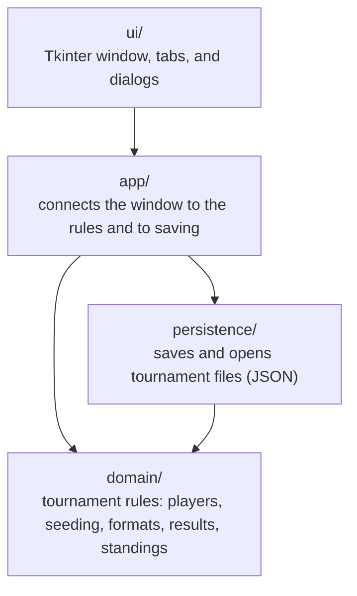
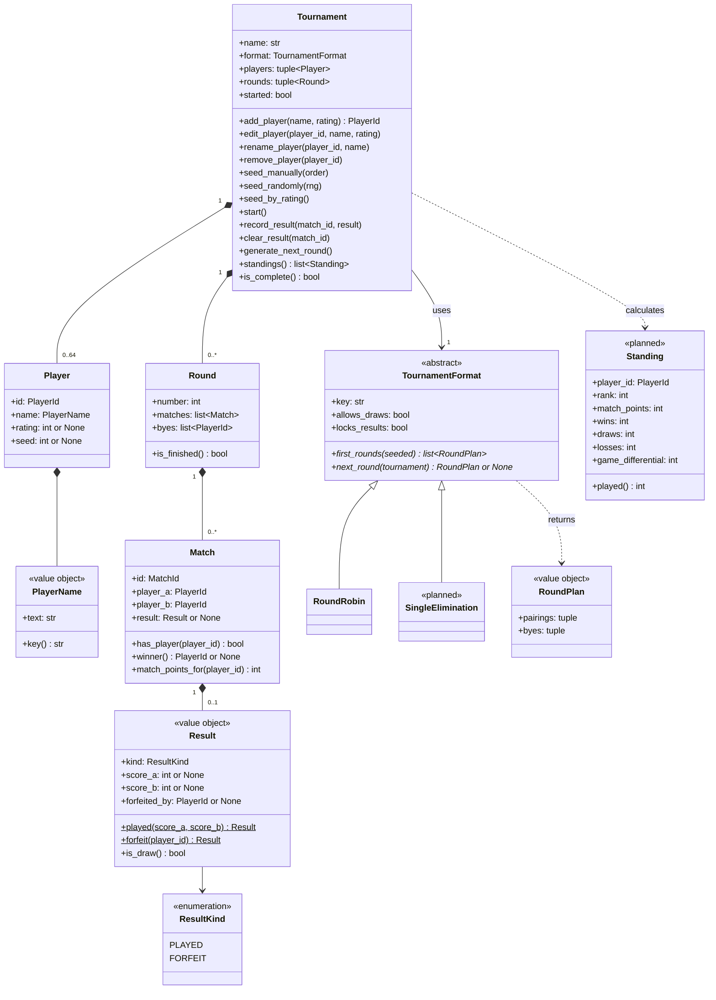

# Design

This document shows how Bracketeer is built to meet its [requirements](requirements/user-stories.md): the layers, the domain classes, the design patterns, and how a tournament is saved. The reasons behind the main choices are in [key-decisions.md](key-decisions.md).

## Layers

Bracketeer is split into layers. Each layer may use the layers below it, never the ones above.



The most important rule is that **the domain layer depends on nothing else**. It does no input or output: no window, no files, no network (NFR-MA-1, checked by an automated test). This has three benefits:

- The tournament rules can be tested quickly, without opening a window or touching a file.
- The window or the save format can change without touching the rules.
- Every rule is enforced in one place, whatever part of the app asks for a change.

Two consequences follow. Randomness is passed into the domain as a `random.Random` object, so a test can fix its seed and get the same result every time. And the domain reports a broken rule by raising a subclass of `DomainError`; the app layer catches it and shows a plain-language message (NFR-US-2).

## Domain classes

The UML class diagram below shows the domain layer. Classes marked `«planned»` are designed but not built yet.



In the diagram, a filled diamond is composition (the part belongs to exactly one whole), a hollow triangle is inheritance, and a dashed arrow means one class creates or returns the other. Methods in italics are abstract, and underlined methods belong to the class rather than an instance (`Result.played` and `Result.forfeit` build a new result). `generate_next_round`, `standings`, and `is_complete` are planned.

### Entities and value objects

- An **entity** keeps its identity while its data changes. A `Player` is still the same player after a name correction, and a `Match` is still the same match when its result is entered or cleared. Entities compare by identity (`eq=False` on their dataclasses).
- A **value object** is defined only by its values and never changes after it's created (a frozen dataclass). To "change" one, you replace it. `PlayerName`, `Result`, `RoundPlan`, and `Standing` are value objects. Because `PlayerName` checks its own rules when it's created, an invalid name can't exist anywhere in the program.
- **`Tournament` is the aggregate root.** Every change goes through its methods, and outside code refers to players and matches by ID. That way each rule (for example, "names are unique" or "results in a locked round can't change") is checked in exactly one place.
- **Standings and completion are calculated, never stored.** They are worked out from the results each time they're needed, so they can never disagree with the results.

## Design patterns

### Strategy: tournament formats

Each tournament format plans rounds differently, but a tournament treats them all the same way.

| Strategy role     | In Bracketeer                                                                 |
| ----------------- | ----------------------------------------------------------------------------- |
| Strategy          | `TournamentFormat`, an abstract base class                                    |
| Concrete strategy | `RoundRobin`, `SingleElimination`                                             |
| Context           | `Tournament`, which holds a format and calls it without knowing which it is   |
| Client            | The app layer, which picks a format when the organizer creates a tournament   |

A format **answers questions and never changes the tournament**. `first_rounds()` returns `RoundPlan` objects (who plays whom, and who has a bye), and `Tournament` turns each plan into a numbered `Round` with numbered `Match` objects. Match numbers are therefore handed out in one place. A format also declares two rules as class attributes: `allows_draws` (R-RS-2) and `locks_results` (R-RS-7).

Adding a format, such as double elimination later, means adding one new class. `Tournament` and the existing formats don't change, which is the open/closed principle: open for extension, closed for modification.

`TournamentFormat` is an abstract base class (`abc.ABC`), so a format class that forgets to define a required method fails as soon as it's created, rather than later when the method is called.

### Repository: saving tournaments

`TournamentRepository` (in `persistence/`) is the only code that reads or writes tournament files. The rest of the app asks it to `save(tournament, path)` or `load(path)` and never deals with JSON directly. This keeps file handling out of the domain, and it means the save format could change (for example, to a database) without touching the rules or the window.

### Command: undo and redo (only if US-08 is built)

Each undoable action would be an object with `execute()` and `undo()`. `execute()` remembers the previous value (such as the old result) before making the change, and `undo()` puts it back. A history object keeps an undo stack and a redo stack. Generating a single elimination round can't be undone, because it locks the earlier results (R-RS-7), so it clears the history.

## Saving a tournament

A tournament is saved as one JSON file. Only the facts are stored: the players, their seeds, the rounds, and the results. Standings are recalculated when the file is opened. A shortened example:

```json
{
  "format_version": 1,
  "name": "Friday Smash Night",
  "format": "round_robin",
  "started": true,
  "players": [
    { "id": 1, "name": "Ana", "rating": 1500, "seed": 1 },
    { "id": 2, "name": "Ben", "rating": null, "seed": 2 }
  ],
  "rounds": [
    {
      "number": 1,
      "byes": [],
      "matches": [
        {
          "id": 1,
          "player_a": 1,
          "player_b": 2,
          "result": { "kind": "played", "score_a": 2, "score_b": 1 }
        }
      ]
    }
  ]
}
```

- `format_version` lets a future version recognize older files and refuse newer ones (NFR-RE-3).
- `format` stores the format's key; the format itself holds no data, so the key is enough to recreate it.
- Opening a file treats it as untrusted input: every value is checked before a tournament is rebuilt from it, and anything invalid produces a message instead of a crash (NFR-RE-2, NFR-SE-4).
- Saving writes a complete new file first and then replaces the old one, so a failed save never leaves a half-written file (NFR-RE-1).

## Sources

- Mermaid class diagrams: https://mermaid.js.org/syntax/classDiagram.html
- UML class diagram notation: https://www.uml-diagrams.org/class-diagrams-overview.html
- Strategy pattern: https://refactoring.guru/design-patterns/strategy
- Repository pattern (Martin Fowler): https://martinfowler.com/eaaCatalog/repository.html
- Command pattern: https://refactoring.guru/design-patterns/command
- Value objects (Martin Fowler): https://martinfowler.com/bliki/ValueObject.html
- Aggregates (Martin Fowler): https://martinfowler.com/bliki/DDD_Aggregate.html
- Python `abc` module: https://docs.python.org/3/library/abc.html
- Python `json` module: https://docs.python.org/3/library/json.html
