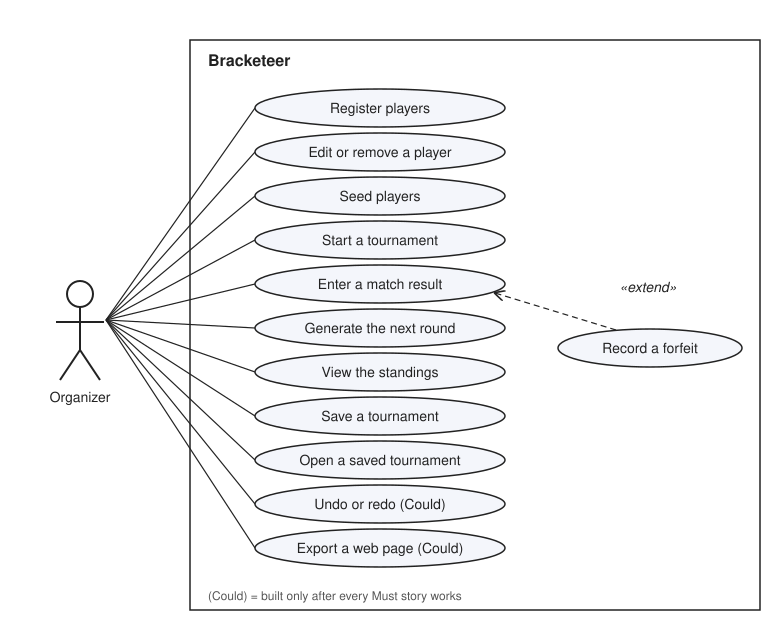

# User Stories

These are Bracketeer's functional requirements, written from the point of view of the person who uses it: the tournament organizer.

Each story follows the form "As a _role_, I want _something_ so that _benefit_." Its acceptance criteria use the form **Given** a starting situation, **when** an action happens, **then** an observable result follows. Each criterion is specific enough to check, and wherever possible it becomes an automated test that names the story and criterion (for example, `US-01 #2`). Rule IDs such as `R-RS-2` refer to [domain-rules.md](domain-rules.md), and IDs such as `NFR-RE-2` refer to [non-functional.md](non-functional.md).

Every story is also a GitHub issue, with its criteria as a checklist.

## Use case diagram

The diagram shows what the organizer can do with Bracketeer. Each use case maps to one or more stories below.

## Story index

Priorities use MoSCoW: **Must** (needed for v1.0), **Should** (important and planned for v1.0, but the release still works without it), **Could** (built only after every Must works), and **Won't** (considered and deliberately left out of this release).

| ID    | Story                                    | Priority |
| ----- | ---------------------------------------- | -------- |
| US-01 | Register players                         | Must     |
| US-02 | Edit or remove a player                  | Must     |
| US-03 | Seed players                             | Must     |
| US-04 | Run a single elimination tournament      | Must     |
| US-05 | Run a round robin tournament             | Must     |
| US-06 | Run a Swiss tournament                   | Won't    |
| US-07 | Enter a match result                     | Must     |
| US-08 | Undo and redo                            | Won't    |
| US-09 | View the standings                       | Must     |
| US-10 | Save and open a tournament               | Must     |
| US-11 | Export a tournament as a web page        | Should   |
| US-12 | Run Bracketeer without installing Python | Must     |
| US-13 | Withdraw a player mid-tournament         | Won't    |
| US-14 | Import players from a CSV file           | Won't    |
| US-15 | Run a double elimination tournament      | Won't    |
| US-16 | Publish an exported bracket online       | Won't    |

**Not stories:**

- AI-assisted seeding is a Won't for this release. Its requirements are written up as a proposal in [ai-smart-seeding.md](ai-smart-seeding.md).
- The demo-data script creates sample tournaments for the report and presentation screenshots, not for an organizer, so it is a task, not a story.

---

## US-01: Register players

**Priority:** Must

As an organizer, I want to register players by name, with an optional rating, so that I can build the field for my tournament.

1. **Given** a tournament that hasn't started, **when** I add a player named "Ana", **then** "Ana" appears in the player list.
2. **Given** a player named "Ana" is registered, **when** I add a player named "ana", **then** the player isn't added, and I see a message that the name is already taken (R-PL-2).
3. **Given** a tournament that hasn't started, **when** I add a player with a blank name or a name over 40 characters, **then** the player isn't added, and I see a message explaining why (R-PL-2).
4. **Given** a tournament that hasn't started, **when** I enter a rating of "abc" or -5, **then** the player isn't added and I see a message. Leaving the rating empty is allowed (R-PL-3).
5. **Given** a tournament with 64 players, **when** I try to add another player, **then** the player isn't added, and I see a message about the limit (R-PL-1).

## US-02: Edit or remove a player

**Priority:** Must

As an organizer, I want to fix or remove a registration so that mistakes don't carry into the event.

1. **Given** a tournament that hasn't started, **when** I change a player's name or rating, **then** the player list shows the new values. The same name checks as US-01 apply.
2. **Given** a tournament that hasn't started, **when** I remove a player, **then** the player disappears from the list. If seeds were assigned, the remaining seeds are renumbered 1 to _n_ with no gaps.
3. **Given** a tournament that has started, **when** I correct a player's name, **then** the new name appears everywhere, including past results (R-PL-4).
4. **Given** a tournament that has started, **then** I can't add or remove players (R-PL-4).

## US-03: Seed players

**Priority:** Must

As an organizer, I want to seed players manually, randomly, or by rating so that the strongest players don't meet too early.

1. **Given** 8 registered players, **when** I choose random seeding, **then** every player gets a unique seed from 1 to 8 (R-SD-1).
2. **Given** players rated 1500, 1800, and 1200, **when** I choose seeding by rating, **then** the 1800 player is seed 1, the 1500 player is seed 2, and the 1200 player is seed 3 (R-SD-2).
3. **Given** a mix of rated and unrated players, **when** I seed by rating, **then** every unrated player comes after every rated player, in registration order (R-SD-2).
4. **Given** seeded players, **when** I move a player to seed 1, **then** the other players shift down, and seeds stay unique from 1 to _n_.
5. **Given** a tournament that has started, **then** seeds can't be changed (R-SD-3).

## US-04: Run a single elimination tournament

**Priority:** Must

As an organizer, I want to run a single elimination bracket so that I can hold a quick knockout event.

1. **Given** 8 seeded players, **when** I start the tournament, **then** round 1 is 1 v 8, 4 v 5, 2 v 7, and 3 v 6 (R-SE-2).
2. **Given** 6 seeded players, **when** I start the tournament, **then** seeds 1 and 2 get byes, and round 1 has two matches: 4 v 5 and 3 v 6 (R-SE-1).
3. **Given** a round with results still missing, **then** I can't generate the next round (R-RD-1).
4. **Given** every result in a round is entered, **when** I generate the next round, **then** the winners are paired by their bracket positions (R-SE-3).
5. **Given** the final is complete, **then** the champion is shown, and the standings follow R-SE-4, with the losing semifinalists sharing 3rd.
6. **Given** any number of players from 2 to 64, **then** the finished tournament has exactly _n_ − 1 matches and exactly one champion (R-SE-3).

## US-05: Run a round robin tournament

**Priority:** Must

As an organizer, I want to run a round robin so that every player plays every other player once.

1. **Given** 6 seeded players, **when** I start the tournament, **then** 5 rounds of 3 matches are generated, and every pair of players meets exactly once (15 matches) (R-RR-1, R-RR-2).
2. **Given** 7 seeded players, **when** I start the tournament, **then** 7 rounds are generated. Each round has one bye, every player gets exactly one bye, and there are 21 matches (R-RR-2).
3. **Given** any number of players from 2 to 64, **then** no player appears twice in any round (R-RD-2).
4. **Given** a round robin in progress, **when** I enter results in any order, including later rounds first, **then** each result is accepted (R-RR-3).

## US-06: Run a Swiss tournament

**Priority:** Won't (this release)

As an organizer, I want to run a Swiss tournament so that a large field gets competitive matches in a few rounds without anyone being eliminated.

_Why not now:_ Swiss pairing (score groups, avoiding rematches, assigning byes) is the most complex format by far, and the two v1.0 formats already cover the common small-event cases.

## US-07: Enter a match result

**Priority:** Must

As an organizer, I want to enter each match's game score, or a forfeit when a player doesn't play, so that the bracket and standings stay up to date.

1. **Given** a round robin match between Ana and Ben, **when** I enter 2–1 for Ana, **then** Ana gets 3 match points and Ben gets 0 (R-RS-1, R-RS-3).
2. **Given** a round robin match between Ana and Ben, **when** I enter 1–1, **then** the match is recorded as a draw, and each player gets 1 match point (R-RS-2, R-RS-3).
3. **Given** a single elimination match, **when** I enter 2–2, **then** the result is rejected with a message that elimination matches need a winner (R-RS-2).
4. **Given** any match, **when** I enter a negative or non-numeric score, **then** the result is rejected with a message (R-RS-1).
5. **Given** a single elimination tournament where the next round has been generated, **when** I try to change a result from an earlier round, **then** the change is rejected with a message explaining why (R-RS-7).
6. **Given** a match between Ana and Ben where Ben didn't play, **when** I record a forfeit by Ben, **then** Ana gets 3 match points, Ben gets 0, no game score is recorded, and in single elimination Ana advances (R-RS-5).
7. **Given** a match with a result, **when** I clear the result, **then** the match is unplayed again and the standings update. In single elimination, this is allowed only until the next round is generated (R-RS-7).

## US-08: Undo and redo

**Priority:** Won't (this release)

As an organizer, I want to undo and redo my changes during a tournament so that I can fix a mistake quickly.

_Why not now:_ clearing a result and entering it again (US-07 #7) already fixes a mistake, so undo would be a second way to do the same thing. The acceptance criteria below are kept for a future release.

1. **Given** I just entered a result, **when** I choose undo, **then** the match goes back to unplayed, and the standings return to what they were before.
2. **Given** I just undid a result, **when** I choose redo, **then** the result and the standings are restored.
3. **Given** I undid a result, **when** I enter a different result, **then** redo is no longer available.
4. **Given** a single elimination tournament, **when** I generate the next round, **then** the earlier results can no longer be undone (R-RS-7).
5. **Given** I open a saved tournament, **then** the undo and redo history starts empty.
6. **Given** a tournament that has started, **when** I correct a player's name and then choose undo, **then** the previous name is restored.

## US-09: View the standings

**Priority:** Must

As an organizer, I want to see the current standings so that players always know where they stand.

1. **Given** a tournament in progress, **when** I enter or clear a result, **then** the standings update immediately.
2. **Given** any tournament, **then** the standings list every registered player exactly once (R-TB-1).
3. **Given** a round robin where Ana and Ben have equal match points and Ana's game differential is higher, **then** Ana ranks above Ben (R-TB-2).
4. **Given** players who are tied on every other criterion, **then** they are ordered by original seed, with the lower seed number ranked higher (R-TB-3).
5. **Given** a single elimination tournament, **then** players are ranked by the round in which they were eliminated (R-TB-4).
6. **Given** any standings, **then** each player's matches played, wins, draws, losses, and match points are shown.

## US-10: Save and open a tournament

**Priority:** Must

As an organizer, I want to save a tournament as a file on my computer so that I can close Bracketeer and continue later without losing anything.

1. **Given** a tournament in progress, **when** I save it, close Bracketeer, and open the file again, **then** the players, seeds, rounds, results, and standings are exactly as I left them.
2. **Given** a tournament with unsaved changes, **when** I close Bracketeer, start a new tournament, or open another file, **then** I'm asked whether to save first (NFR-RE-4).
3. **Given** I choose Open, **then** I'm asked for the file's path, and pressing Enter without typing one returns to the menu with nothing changed.
4. **Given** a damaged or unreadable file, **when** I open it, **then** I see an error message, Bracketeer doesn't crash, and the file isn't changed (NFR-RE-2).
5. **Given** a file saved by a newer version of Bracketeer, **when** I open it, **then** it's refused with a message (NFR-RE-3).

## US-11: Export a tournament as a web page

**Priority:** Should

As an organizer, I want to export a tournament as a web page so that I can share the bracket and standings with players.

1. **Given** a tournament, **when** I export it and choose where to save it, **then** a single HTML file is created there, showing the rounds, results, and standings.
2. **Given** an exported file, **when** I open it in a web browser without an internet connection, **then** it displays correctly (NFR-PO-3).
3. **Given** a player named ``, **when** I export and open the page, **then** the name appears as plain text, and no script runs (NFR-SE-2).
4. **Given** I choose Export, **then** I'm asked for a path, and the file is written only there (NFR-SE-5).

## US-12: Run Bracketeer without installing Python

**Priority:** Must

As an organizer, I want to download and run Bracketeer as a single program so that I don't need to install Python or anything else.

1. **Given** a Windows 11 computer without Python installed, **when** I download `Bracketeer.exe` from the GitHub release and run it, **then** Bracketeer starts (NFR-PO-1).
2. **Given** the release page, **then** it shows the version number and explains the warning Windows may show for an unsigned program.

## US-13: Withdraw a player mid-tournament

**Priority:** Won't (this release)

As an organizer, I want to withdraw a player who leaves partway through so that the tournament can continue fairly.

_Why not now:_ the organizer can already handle this by recording a forfeit for each of the player's remaining matches (US-07 #6), so automating it adds little for v1.0.

## US-14: Import players from a CSV file

**Priority:** Won't (this release)

As an organizer, I want to import players from a CSV file so that I don't have to type a long list by hand.

_Why not now:_ the fields Bracketeer targets are small (up to 64 players), so typing names is manageable.

## US-15: Run a double elimination tournament

**Priority:** Won't (this release)

As an organizer, I want a double elimination bracket so that one bad match doesn't knock a player out.

_Why not now:_ it needs a second (losers') bracket and a grand final, which is a large addition. The format design leaves room for it as a new format class.

## US-16: Publish an exported bracket online

**Priority:** Won't (this release)

As an organizer, I want to publish an exported bracket at a public web address so that players can follow it without receiving a file.

_Why not now:_ Bracketeer makes no network connections (NFR-SE-3), and an exported web page (US-11) can already be posted or shared like any other file.

## Sources

- User stories (Mike Cohn): https://www.mountaingoatsoftware.com/agile/user-stories
- INVEST criteria (Bill Wake): https://xp123.com/articles/invest-in-good-stories-and-smart-tasks/
- Given/When/Then (Martin Fowler): https://martinfowler.com/bliki/GivenWhenThen.html
- MoSCoW prioritization: https://www.agilebusiness.org/dsdm-project-framework/moscow-prioririsation.html
- UML use case diagrams: https://www.uml-diagrams.org/use-case-diagrams.html
